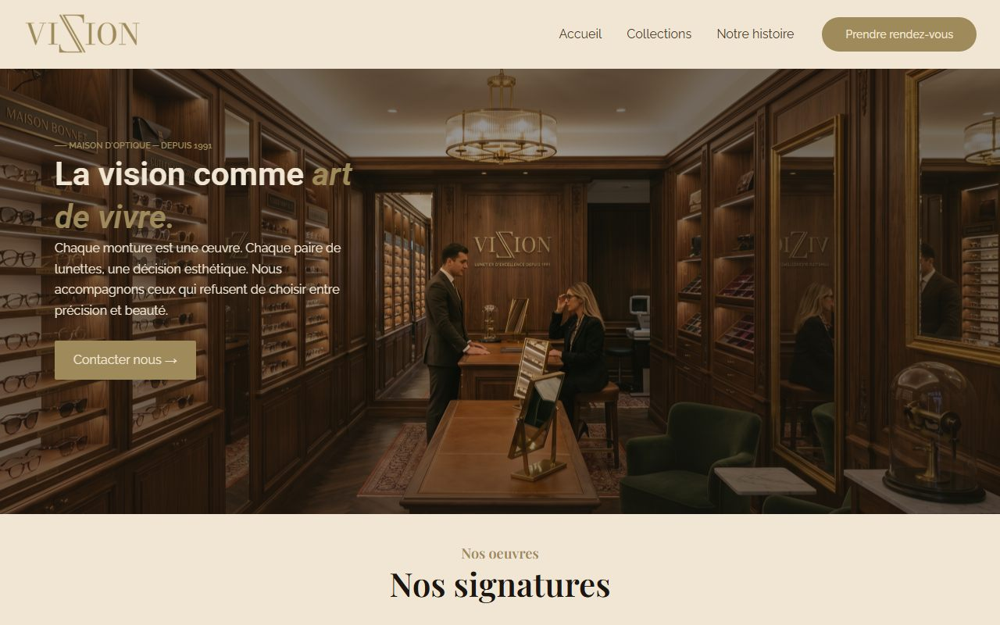

# Portfolio « Game On » – Mathis Beaussier

**Voir le portfolio en ligne : [mathisiut41.github.io](https://mathisiut41.github.io/)**

Portfolio d'un étudiant en **BUT MMI parcours Développement** à l'IUT de Blois, au style arcade néon.
Je recherche un **stage de développement web du 12 avril au 25 juin 2027** (11 semaines).

- Contact : mathisbeaussier@gmail.com
- LinkedIn : [mathis-beaussier](https://www.linkedin.com/in/mathis-beaussier/)

## Projets présentés

| Projet | Technos | Statut |
|---|---|---|
| **viZion** – site vitrine d'une maison d'optique parisienne ([vizion.uno](https://vizion.uno/)) | WordPress, CSS, design graphique | En ligne |
| **PiVert faunes & flores** – site e-commerce en binôme (SAÉ), front et admin refaits en 2026 : panier, comptes, administration, base de données ([site](https://pivert.thecipherbureau.fr) · [code](https://github.com/MathisIUT41/projet-SiteWebPiVert)) | PHP, MySQL, JavaScript, Twig | En ligne |
| **Wordle** – jeu de lettres avec dictionnaire de validation en JSON | JavaScript natif | Jouable |
| **Memory** – jeu de paires avec 7 thèmes, chronomètre et mode deux joueurs | JavaScript natif | Jouable |



## Ce que montre le code

- **Wordle** (`jeux/Wordle/`) : un dictionnaire chargé avec `fetch` dans un `Set` refuse les mots qui n'existent pas. Les couleurs sont calculées en deux passages pour gérer les lettres en double. Le jeu se joue au clavier, à la souris et au doigt.
- **Memory** (`jeux/mémorie/`) : la grille s'adapte au nombre de paires, les clics sont bloqués pendant la vérification d'une paire, et le mode deux joueurs gère le tour par tour.
- **Portfolio** (`portfolio.js`) : fond de particules en Canvas, effet machine à écrire, titre glitch. Les animations respectent le réglage « réduire les animations » du système.

## Lancer le site en local

Ouvre `index.html` dans un navigateur. Le Wordle charge ses mots en JSON : pour qu'il fonctionne, lance plutôt un petit serveur local, par exemple l'extension **Live Server** de VS Code.

Le site est publié avec GitHub Pages depuis la branche `main` : chaque `git push` le met à jour.

## Structure

```
├── index.html          Page d'accueil
├── Projets.html        Fiches détaillées des projets
├── CV/                 Version web du CV
├── jeux/               Wordle, Memory, Pendu (en cours)
├── Images/             Visuels et captures
├── styles.css          Style principal (responsive)
└── portfolio.js        Effets : glitch du titre, fond de particules
```
